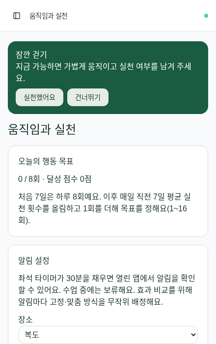

# 시작점 — 공부하는 사이, 짧은 움직임

오래 앉아 공부하는 대학생이 좌석 시간을 기록하고, 수업이 끝난 뒤 가능한 움직임을 제안받아 실천 여부를 돌아보는 웹앱입니다.

**기말 제출 저장소** · [month21/Starting_point](https://github.com/month21/Starting_point)  
[모바일 화면 시연 보기](docs/movement-demo.gif) · [최신 기능 및 시험 결과 · PR #1](https://github.com/month21/Starting_point/pull/1) · [기존 화면 검증 기록](verification.md)

| 확인할 버전 | 구현 범위 |
|---|---|
| 기본 브랜치 `main` | 좌석·집중 타이머, 일·주간 캘린더, 걸음 수 입력 및 활동 분석 |
| 움직임 기능 검토본 PR #1 | 수업 중 알림 보류·종료 후 재평가, 고정·맞춤 운동 추천, 응답 기록, 최근 7일 기반 목표와 실천율 비교 |

### 대표 화면 · 운동 제안에서 실천 기록까지



PR #1의 실제 화면에 예시 응답 데이터를 연결해 촬영했습니다. ‘실천했어요’를 누르면 오늘 목표 8회 중 1회, 달성 점수 13점으로 바뀝니다. 운영 DB 연동 시연과 실제 사용자 대상 효과 검증은 남아 있습니다.

초기 형상관리계획서에 기록된 저장소는 [songhb2005/HY_Lab](https://github.com/songhb2005/HY_Lab)입니다. 기말 기준 코드와 변경 이력은 이 저장소에서 확인할 수 있습니다.

## 기본 브랜치의 기능

| 영역 | 제공 기능 |
|---|---|
| 좌석 시간 | 시작·일시정지·종료 제어, 누적 시간, 세션 저장 |
| 집중 세션 | 과목·업무 라벨, 실시간 경과 시간, 일일 세션 이력 |
| 시간 캘린더 | 일/주 보기, 직접 기록, 카드 드래그로 30분 단위 시간 변경, 수정 대화상자 |
| 활동 분석 | 수동 걸음 수 입력, CSV·TSV·Apple Health XML 가져오기, 14일 추세, 걸음 수 대비 집중·좌석 시간 상관계수 |

## 개발 환경

프로젝트는 React, TypeScript, Tailwind CSS, Express, tRPC, Drizzle ORM으로 구성됩니다. 사용자 인증과 데이터베이스 환경 변수는 배포 환경에서 제공되어야 합니다.

```bash
pnpm install
pnpm drizzle-kit generate
pnpm dev
```

스키마 변경 후에는 생성된 SQL을 검토하고 운영 데이터베이스에 적용해야 합니다. 배포 전에는 아래 검증 명령을 실행합니다.

```bash
pnpm check
pnpm test
pnpm build
```

## 건강 데이터 가져오기

`활동 분석` 화면에서 날짜와 걸음 수 열이 있는 CSV 또는 TSV 파일을 선택하거나, Apple Health에서 내보낸 XML을 선택합니다. 가져오기 과정에서는 일별 걸음 수만 추출하여 계정에 저장하며, 원본 파일 자체는 서버에 업로드하거나 저장하지 않습니다.
